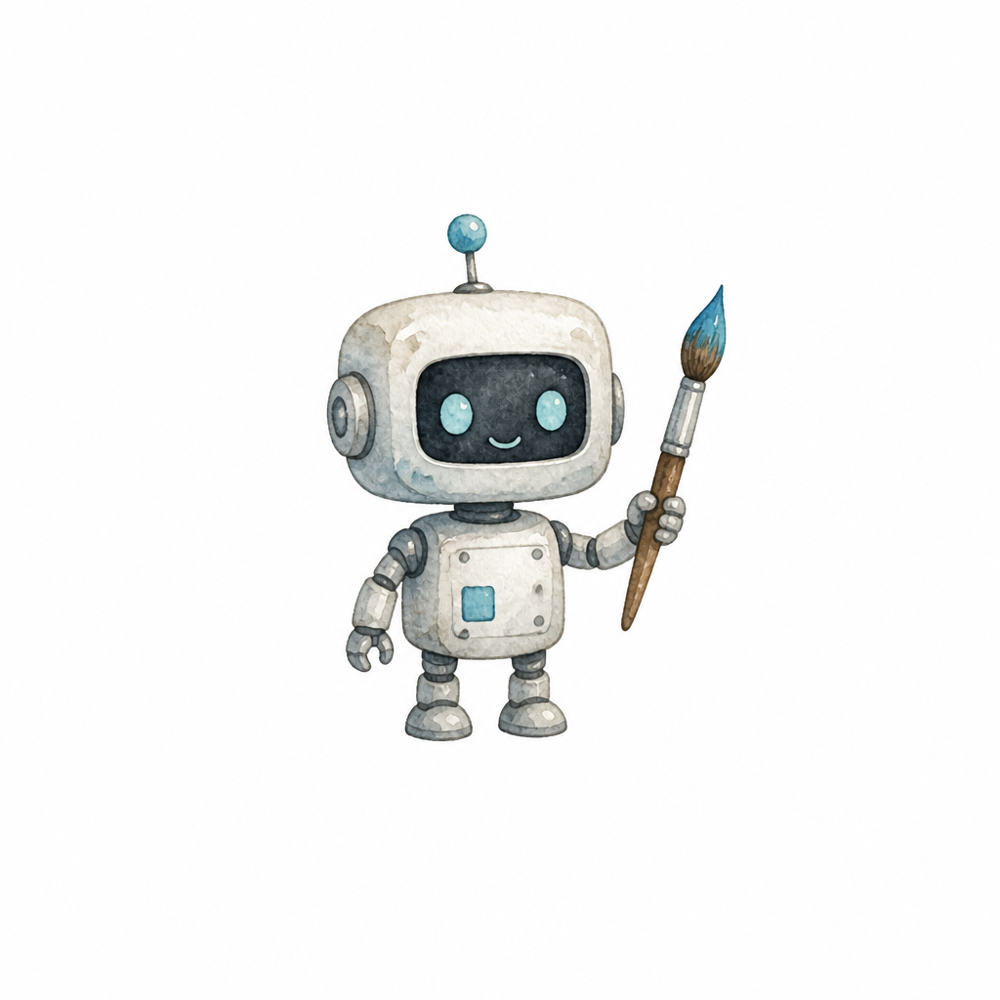
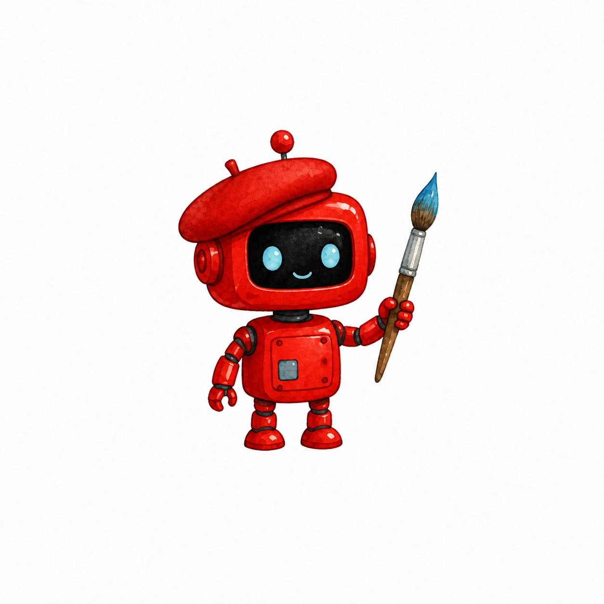

# imagegen

imagegen is a command-line tool that generates and edits images through OpenAI's Images API, written for coding agents and the scripts around them. Agents build things that need pictures all the time: the hero image and og:image for a landing page they have just scaffolded, placeholder product photos for a demo, icons and logos for a prototype, textures for a game jam entry, test fixtures for an image pipeline. Without a tool for the job, an agent either stops to ask you for assets or ships gray rectangles.

```bash
imagegen generate "a tiny watercolor robot holding a paintbrush" -o robot.png
imagegen edit "make the robot bright red and give it a beret" -i robot.png -o robot-red.png
```

| generate | edit |
|---|---|
|  |  |

Both images came from those two commands, unretouched.

## How it works

The best interface to give an agent is a boring, generic command-line tool, because it composes with what the agent already knows: pipes, loops, exit codes and `$(...)`. imagegen keeps its output predictable enough for that to work. The absolute path of each saved image goes to stdout, one per line, and progress and warnings go to stderr, so a command substitution captures the path and nothing else:

```bash
imagegen edit "turn it into a pencil sketch" \
  -i "$(imagegen gen "a lighthouse at dusk" -q low --quiet)" -o sketch.png
```

`--json` swaps those paths for a structured result that adds byte sizes and the token usage OpenAI reports. Exit codes help an agent decide what to change: code 3 covers moderation blocks and other image-generation user errors, while code 2 covers authentication and argument-parser failures. Read stderr before acting; `authentication failed` distinguishes credentials errors from an unknown flag or a missing prompt. A malformed size, an empty prompt or a missing input file fails before any request goes out, which means those mistakes cost nothing.

Underneath is a small Rust binary. `generate` posts JSON to `/images/generations`, `edit` uploads its input images and optional mask as a multipart form to `/images/edits`, and both decode the returned image and write it to disk, creating the output directory if it needs to. The repository also ships a [skill](skill/SKILL.md) that tells Claude Code or Codex when to reach for the tool and how to weigh size, quality and cost.

## Install

With Homebrew on macOS or Linux, which builds from source:

```bash
brew tap chrischabot/imagegen
brew install chrischabot/imagegen/imagegen
```

Homebrew 6 and later won't load a third-party formula you haven't trusted, and installing by the fully qualified name trusts this formula alone.

With cargo, using Rust 1.87 or newer:

```bash
cargo install --git https://github.com/chrischabot/imagegen-cli
```

From a checkout, `cargo install --path .` does the same.

## Authentication

Pass `--api-key sk-...` or set `OPENAI_API_KEY`; the flag wins when both are present. It has to be a platform API key, because the OAuth tokens behind ChatGPT and Codex logins are scoped to the ChatGPT backend and can't call `/v1/images`. OpenAI may also require [organization verification](https://help.openai.com/en/articles/10910291-api-organization-verification) before it serves GPT Image models.

## Teach it to your agent

The skill is a single file, so you don't need a checkout to install it:

```bash
mkdir -p ~/.claude/skills/imagegen
curl -fsSL https://raw.githubusercontent.com/chrischabot/imagegen-cli/main/skill/SKILL.md \
  -o ~/.claude/skills/imagegen/SKILL.md
```

Codex reads the same format from `~/.agents/skills/imagegen/`. For a single project, use `.claude/skills/imagegen/` or `.agents/skills/imagegen/` inside the repository. From then on, asking the agent for "a hero image for this page" or to "make the logo red" should send it to imagegen with sensible flags.

## Usage

### Generate

```bash
imagegen generate "minimal flat vector banner, mountains at sunrise" \
  -q low -s 1280x768 -f jpeg -c 80 -o banner/
```


```
Usage: imagegen generate [OPTIONS] <PROMPT>   (alias: gen)

  -m, --model <MODEL>              model name, gpt-image-2 by default
  -s, --size <SIZE>                WIDTHxHEIGHT or 'auto' (default)
  -q, --quality <QUALITY>          auto (default), low, medium, high
  -f, --format <FORMAT>            png (default), jpeg, webp
  -c, --compression <0-100>        compression for jpeg/webp
  -b, --background <BACKGROUND>    auto, opaque, transparent
      --moderation <MODERATION>    auto, low
  -n, --n <1-10>                   number of images, 1 by default
  -o, --out <PATH>                 output file or directory
      --json                       machine-readable output
      --quiet                      suppress progress on stderr
      --api-key / --base-url / --timeout
```

With no `-o`, files land in the current directory, named from the prompt and a timestamp (`neon-city-at-night-20260704-195806.png`). `-o dir/` puts auto-named files in that directory, and `-o file.png` uses exactly that name, replacing any file already there; with `-n 3` you get `file-1.png`, `file-2.png` and `file-3.png`.

`--base-url`, or the `OPENAI_BASE_URL` environment variable, points the tool at a proxy or compatible endpoint. `--timeout` defaults to 300 seconds, because large, high-quality images can take minutes.

### Edit

```bash
# restyle
imagegen edit "make it look like a pencil sketch" -i photo.png -o sketch.png

# combine references
imagegen edit "the robot painting the mountain scene" -i robot.png -i banner.jpeg -o mashup.png

# inpaint with a PNG mask, whose transparent pixels mark the region to replace
imagegen edit "replace with a bookshelf" -i room.png --mask hole.png -o out.png
```

`edit` takes the same options as `generate`, apart from `--moderation`, which it ignores. It also has `--fidelity low|high`, which sets how closely the result preserves the input images. Leave it off with gpt-image-2, which always works at high fidelity and doesn't allow changing it.

### Models

```bash
imagegen models          # image models available to your key
imagegen models --json
```

`--model` goes to the API exactly as you write it, and the default is `gpt-image-2`. OpenAI recommends `gpt-image-2.6-flare` and `gpt-image-2.6-sunburst` as replacements for older GPT Image models, and you can select them by name, although `--quality` stops at `high` and can't reach their `xhigh` and `max` settings. The older models are closing down: [OpenAI's deprecation schedule](https://platform.openai.com/docs/deprecations) shows `gpt-image-1` shut down on October 23, 2026, with `gpt-image-1.5` and `gpt-image-1-mini` following on December 1, 2026.

### JSON output

```bash
imagegen gen "a red circle" -q low --json
```

A result has this shape:

```json
{
  "background": "opaque",
  "elapsed_seconds": 18.0,
  "images": [
    {
      "bytes": 899573,
      "path": "/abs/path/a-red-circle-20260704-195806.png",
      "revised_prompt": null
    }
  ],
  "model": "gpt-image-2",
  "operation": "generate",
  "output_format": "png",
  "quality": "low",
  "size": "1024x1024",
  "usage": {
    "input_tokens": 17,
    "output_tokens": 196,
    "total_tokens": 213
  }
}
```

`size`, `quality`, `output_format` and `background` are the values the API reports, which is how you find out what `auto` chose.

## gpt-image-2 cheat sheet

- **Sizes:** both edges must be multiples of 16, the longest edge at most 3840, the aspect ratio at most 3:1 and the total between 655,360 and 8,294,400 pixels. Popular choices are `1024x1024`, `1536x1024`, `1024x1536`, `2048x1152` and `3840x2160`, and square images are usually fastest. The CLI warns on stderr about a size outside these limits but still sends the request.
- **Cost:** OpenAI's [published output prices](https://platform.openai.com/docs/guides/image-generation) for a 1024×1024 image are about $0.006 at low quality, $0.053 at medium and $0.211 at high, so draft at `low` and finish at `medium` or `high`. Edits can cost more, because gpt-image-2 processes every input image at high fidelity.
- **Transparency:** OpenAI added [preview support for transparent backgrounds](https://developers.openai.com/api/docs/changelog#august-2026) to gpt-image-2; use `-b transparent -f png` or `-b transparent -f webp`. For new workflows, `-m gpt-image-2.6-flare` also supports transparent PNG and WebP; see the [image generation guide](https://developers.openai.com/api/docs/guides/image-generation#transparent-backgrounds).

## Exit codes

| Code | Meaning |
|---|---|
| 0 | success |
| 1 | API or network error |
| 2 | missing or rejected credentials, including any HTTP 401 or 403, or a command line the argument parser rejects |
| 3 | moderation block or another image-generation user error; check stderr and change the prompt or input images before retrying |
| 4 | malformed size, empty prompt or missing input file |

## Development

```bash
cargo test            # unit tests, no network
cargo clippy --all-targets -- -D warnings
cargo build --release
```

CI runs these along with `cargo fmt --check` on Ubuntu and macOS. A live smoke test needs an API key and spends about a cent: `cargo run --release -- gen "a red circle" -q low`.

## Project background

- [imagegen-cli project overview](https://chabot.dev/projects/#imagegen-cli) on Chris Chabot’s site.
- [15 minutes from intent to implemented](https://chabot.dev/blog/ninety-minutes-to-a-real-tool/): the CLI interface, agent workflow and release process.

## License

[MIT](LICENSE). Copyright (c) 2026 Chris Chabot.
